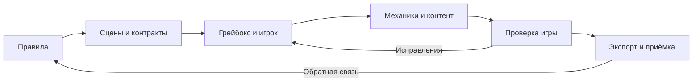
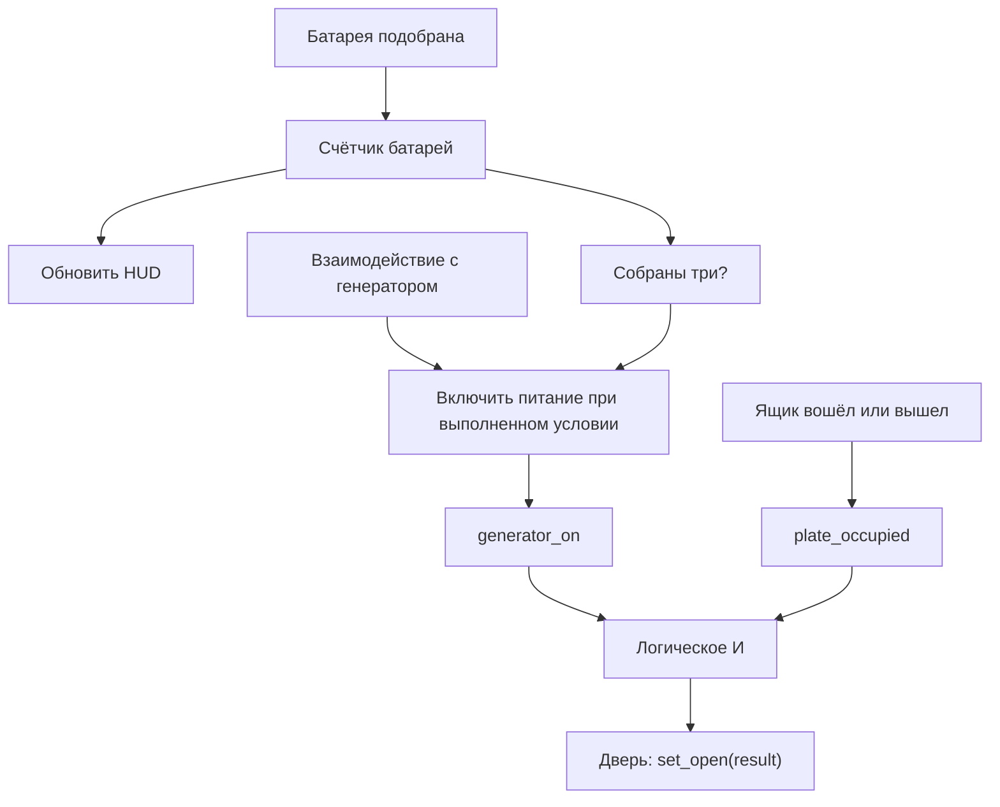
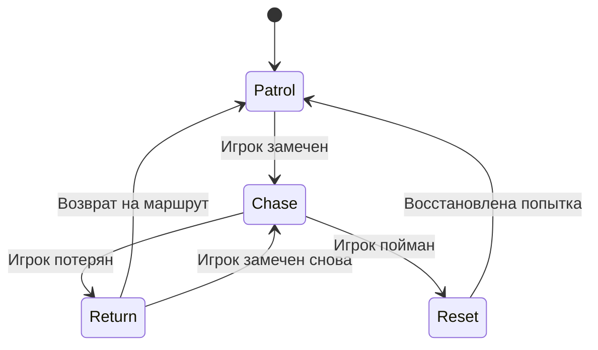

# «Энергоблок»: разработка 3D-игры в обычном Godot

2026-10-10 · учебный пример для Godot 4.7.2.

Этот документ проходит полный цикл небольшой игры: от правил и структуры проекта до проверки экспортированной сборки. Для каждого этапа показаны работа в редакторе, необходимая логика и критерий готовности. [Второй документ](power_room_vr.md) переносит ту же игру в VR и предлагает UX её разработки непосредственно в шлеме.

**Полнота относится к выбранной игре.** В одном небольшом проекте не нужны все возможности движка: сеть, открытый мир, террейн и сложная скелетная анимация здесь не используются. Пример шире MVP диплома и не меняет [план проекта](plan.md) или [приоритеты функций VR-редактора](vr_feature_map.md). Это описание учебного проекта, а не отчёт о реализованной игре в репозитории.

## Игра и критерий завершения

«Энергоблок» — небольшая 3D-головоломка от первого лица. Игрок оказывается в технической комнате и должен восстановить питание, чтобы выйти.

- Нужно собрать три батареи и активировать генератор.
- Одна батарея находится на площадке, до которой добираются с помощью движущейся платформы.
- Робот патрулирует комнату, преследует замеченного игрока и при поимке возвращает его к контрольной точке.
- Выходная дверь открывается, пока одновременно включён генератор и ящик стоит на нажимной плите.
- Есть главное меню, настройки, пауза, продолжение с контрольной точки и экран победы.

Управление: WASD — движение, мышь — взгляд, Space — прыжок, E — взаимодействие, Esc — пауза. Ящик игрок толкает; взаимодействие с батареей подбирает её.

**Сквозная приёмка:** новая игра → собрать батареи → включить генератор → сохранить контрольную точку → закрыть приложение → продолжить → поставить ящик на плиту → пройти в выход → увидеть победу.

[Интерактивная карта комнаты и объектов](assets/power_room_desktop.html) показывает, какие ноды, настройки и проверки относятся к каждому объекту. HTML нужно открыть в браузере; это поясняющая схема, а не сама игра.

## От процесса разработки ПО к разработке игры

| Привычный этап backend-разработки | В этой игре | Результат |
| --- | --- | --- |
| Анализ | Правила, действия игрока, условия победы и ошибки | Проверяемый игровой сценарий |
| Проектирование | Структура сцен, ответственность объектов, сигналы, формат сохранения | Модель игры и связи между её частями |
| Разработка | Код, сборка уровня, импорт моделей, физика, анимация, свет, звук, UI | Рабочая игровая сцена |
| Тестирование | Правила, интеграция, пространственная достижимость, удобство, производительность | Исправленная и проверенная игра |
| Развёртывание | Экспорт, запуск без редактора, проверка ресурсов и сохранений | Дистрибутив |

Редактор объединяет несколько видов работы: сборку данных сцены, настройку компонентов, просмотр ресурсов, анимацию и запуск игры. Аналогия с IDE полезна, но ограничена: большую часть результата приходится оценивать движением, изображением и звуком.



Этапы ниже объясняются последовательно, но на практике образуют короткие итерации: собрать небольшую часть → запустить → найти проблему → исправить.

## 1. Сформулировать правила

Сначала записываем, что игрок может сделать и что должно произойти. Полезно отделять видимый эффект от правила: исчезновение батареи — эффект, а запрет повторного начисления — правило.

| Ситуация | Ожидаемый результат |
| --- | --- |
| Игрок взаимодействует с доступной батареей | Счётчик увеличивается один раз, батарея исчезает |
| Собрано меньше трёх батарей | Генератор не включается |
| Три батареи собраны, игрок активирует генератор | Питание включается и создаётся контрольная точка |
| На плиту встал игрок или робот | Это не засчитывается как нужный ящик |
| Ящик убрали с плиты | Дверь закрывается, если проход свободен; защита от зажатия определяется отдельно |
| Игра поставлена на паузу | Мир остановлен, меню доступно |
| Загружена контрольная точка | Мир восстановлен в согласованное состояние |

Для простого варианта при поимке до генератора начинается попытка заново. После генератора восстанавливается состояние контрольной точки, описанное на этапе 12. Политику закрытия двери при занятом проёме также нужно реализовать явно, например откладывать закрытие, пока проём занят.

**В редакторе:** пока достаточно тестовой сцены и списка объектов. Основная работа — анализ правил.

**Проверка:** каждый пункт можно воспроизвести и однозначно определить, выполнен ли он. Это аналог acceptance criteria, а не перечень кнопок редактора.

## 2. Разделить игру на сцены и настроить проект

Создаём проект, назначаем главную сцену и настраиваем Input Map. Скрипты обращаются к действиям `move_forward`, `move_back`, `move_left`, `move_right`, `jump`, `interact`, `pause`, а не к конкретным клавишам.

Предлагаемая структура:

```text
App.tscn
├── SceneHost              # Menu.tscn or Level.tscn
├── SaveService
└── SettingsService

Level.tscn
├── Geometry
├── Player                 # Player.tscn
├── Batteries              # Three Battery.tscn instances
├── Generator              # Generator.tscn
├── Crate                  # Crate.tscn
├── PressurePlate          # PressurePlate.tscn
├── Door                   # Door.tscn
├── MovingPlatform         # MovingPlatform.tscn
├── Robot                  # Robot.tscn
├── NavigationRegion3D
├── Environment
├── ExitArea
└── HUD
```

Сцена в Godot — сохраняемое дерево нод, которое можно создать как экземпляр внутри другой сцены. `Battery.tscn` объединяет внешний вид, коллизию и поведение батареи. Три её экземпляра используют общую заготовку, но имеют собственные позиции и состояние.

Скрипт уровня координирует объекты; батарея не должна сама искать HUD, дверь и сервис сохранения. Это похоже на разделение доменных компонентов и прикладной координации, хотя дерево сцены не является DI-контейнером.

**В редакторе:** создание сцен, дерево нод, переименование, смена родителя, сохранение ветки как отдельной сцены, создание экземпляров и назначение скриптов.

**Проверка:** запуск проекта открывает меню, «Новая игра» загружает уровень, повторный запуск создаёт чистое состояние.

## 3. Собрать грейбокс комнаты

Грейбокс — уровень из простых объёмов, предназначенный для проверки пространства до появления окончательных моделей.

Из CSG-примитивов собираем пол, стены, проём двери, площадку и путь платформы. Размещаем временные батареи, генератор и плиту. Включаем необходимые коллизии: видимая поверхность сама по себе ещё не гарантирует, что игрок на ней стоит.

Используем выбор, перенос, поворот, масштаб, дублирование, удаление, снап к сетке, точные числовые поля Inspector и undo/redo. Проверяем локальные и глобальные оси, чтобы поворот родителя не приводил к неожиданному перемещению дочернего объекта.

**Код:** почти не нужен, но уже нужен тестовый игрок следующего этапа.

**Проверка:** игрок проходит в дверь, помещается в проходах, добирается до платформы и видит основные ориентиры. Красивые модели не исправят неверные габариты комнаты.

## 4. Сделать игрока и взаимодействие

Минимальная сцена игрока:

```text
Player (CharacterBody3D)
├── CollisionShape3D       # Capsule
└── ViewPivot (Node3D)
    └── Camera3D
        └── RayCast3D
```

В скрипте реализуем движение, гравитацию, прыжок, взгляд и взаимодействие. Луч камеры определяет объект перед игроком. По `interact` вызывается согласованный метод интерактивного объекта, например `interact(actor)`.

Ноды дают физическое тело, камеру и запрос пересечения. Правило «по E подобрать батарею» пишет разработчик. Назначение скрипта объекту само по себе не создаёт игровую механику.

**В редакторе:** подбираем размер капсулы, положение камеры, дальность луча и маски столкновений. Экспортируемые параметры скрипта правим через Inspector.

**Проверка:** нельзя пройти сквозь стену, прыгать бесконечно в воздухе или взаимодействовать через закрытую дверь. Для последнего луч должен учитывать препятствия, а не только интерактивные объекты.

## 5. Импортировать и организовать ассеты

Добавляем модели `.glb`, текстуры и аудио в проект. Godot импортирует их, после чего они доступны в FileSystem и Inspector. Проверяем масштаб, оси, материалы и параметры импорта.

Импортированную модель удобно помещать внутрь собственной игровой сцены: `Battery.tscn` содержит модель как дочерний объект, коллизию и `battery.gd`. Так изменение исходной модели не требует заново собирать игровую ответственность.

| Файл | Что хранит | Аналогия для backend-разработчика |
| --- | --- | --- |
| `.tscn` | Дерево нод, их свойства и ссылки на ресурсы | Декларативная сборка объекта |
| `.gd` | Исполняемую логику | Исходный код |
| `.tres` | Текстовое представление ресурса: например материала или собственных данных | Сериализованная конфигурация |
| `.glb`, изображения, аудио | Исходные ассеты для импорта | Входные данные сборки контента |

**`.tres` не означает «граф».** В обычном варианте игры логику пишем на GDScript. В проектируемом VR-редакторе собственный граф логики тоже будет ресурсом и поэтому сможет сохраняться в `.tres`; его формат задаёт плагин.

**Проверка:** изменение общей сцены батареи отражается на её экземплярах, но расстановка трёх батарей остаётся индивидуальной. Переимпорт модели не уничтожает игровую обвязку.

## 6. Настроить физику и области

| Объект | Нода | Кто управляет движением |
| --- | --- | --- |
| Стены и пол | `StaticBody3D` | Не перемещаются во время игры |
| Игрок и робот | `CharacterBody3D` | Скрипт с учётом столкновений |
| Ящик | `RigidBody3D` | Физическая симуляция |
| Платформа и движущаяся часть двери | `AnimatableBody3D` | Анимация или скрипт |
| Плита, зона выхода, область обнаружения | `Area3D` | Обнаруживают пересечения |

Добавляем `CollisionShape3D`, настраиваем форму и размеры. Для ящика подбираем массу и трение. Слоям столкновений даём понятные имена: мир, игрок, переносимые предметы и триггеры.

Слой сообщает, к какой категории относится объект; маска — какие категории он проверяет. Само наличие `Area3D` не означает, что она блокирует движение: это датчик, а не твёрдая поверхность.

Толкание `RigidBody3D` персонажем реализуем явно, например приложением импульса при контакте. Не переписываем позицию физического ящика каждый кадр. Плита отслеживает именно допустимый ящик, а не любое вошедшее тело.

**Проверка:** ящик падает на пол, толкается, удерживается на плите и освобождает её при уходе. Игрок и робот не подменяют ящик в условии.

## 7. Соединить игровые правила

Разделяем ответственность:

- Батарея сообщает `collected(id)` один раз.
- Уровень хранит число собранных батарей и обновляет HUD.
- Генератор принимает взаимодействие и при выполненном условии включает питание.
- Плита сообщает `occupied_changed(value)`.
- Дверь принимает `set_open(value)`.
- Уровень вычисляет итоговое условие и передаёт результат двери.



Сигнал напоминает локальное событие внутри приложения. Это не распределённая очередь: доставку, сохранность и повторную обработку он автоматически не обеспечивает.

**В редакторе:** подключаем сигналы, назначаем ссылки на объекты и настраиваем экспортируемые свойства. **В коде:** описываем условия, смену состояния и защиту от повторного подбора.

**Проверка:** испытываем все четыре комбинации `generator_on` и `plate_occupied`. Запрос на открытие есть только при двух истинных условиях; защиту от закрытия на игроке проверяем отдельно.

## 8. Добавить анимацию

Через `AnimationPlayer` создаём состояния и переходы двери, а также цикл движения платформы. На шкале времени ставим ключи свойств: положение, поворот, интенсивность индикатора.

Код отвечает на вопрос «когда открыть дверь», а анимация — «как меняется её положение со временем». Готовую анимацию можно запускать из скрипта; простое движение также можно описать через Tween.

Движущаяся геометрия и её коллизия должны перемещаться согласованно. Для платформы и двери настраиваем подходящий физический режим обновления анимации и `AnimatableBody3D`.

**Проверка:** открытая дверь не оставляет невидимую коллизию, закрытая действительно блокирует проход, платформа переносит стоящего на ней персонажа. Повторные команды открытия не ломают состояние анимации.

## 9. Добавить робота и навигацию

Создаём `NavigationRegion3D`, запекаем навигационную сетку пола и размещаем точки патруля. Роботу добавляем `NavigationAgent3D`.

Агент вычисляет путь и следующую точку движения, но не перемещает `CharacterBody3D` сам: движение выполняет скрипт робота. Обнаружение игрока тоже отдельная задача: область даёт кандидата, проверка видимости учитывает стены.



Для ограничения сложности робот ходит только по основному полу комнаты и не пользуется движущейся платформой.

**В редакторе:** границы навигации, запекание, точки патруля, радиусы обнаружения. **В коде:** машина состояний, выбор цели, движение и поимка.

**Проверка:** робот обходит стены, не замечает игрока сквозь них и возвращается к патрулю. Отдельно различаем ошибки пути, обнаружения и переходов состояния.

## 10. Настроить внешний вид и звук

Назначаем материалы и текстуры, подбираем цвет и шероховатость поверхностей. В сцену добавляем собственные источники света и `WorldEnvironment`: предпросмотровое освещение редактора не заменяет освещение игры.

Для генератора и двери используем `AudioStreamPlayer3D`, чтобы звук имел позицию в мире. Для фоновой музыки — `AudioStreamPlayer`. Шины Music и SFX позволяют раздельно управлять громкостью. `GPUParticles3D` может показывать искры при запуске генератора.

Скрипты или анимации связывают звук и эффекты с игровыми событиями. Импорт аудиофайла ещё не задаёт момент его воспроизведения.

**Проверка:** в запущенной игре не пропадают свет и окружение; звук генератора меняется с расстоянием; настройки музыки не выключают эффекты. Повторное событие не запускает бесконечно накладывающиеся звуки.

## 11. Собрать игровой интерфейс

Из `Control`, кнопок, подписей и контейнеров собираем главное меню, настройки, паузу и победу. HUD размещаем в `CanvasLayer`: счётчик батарей, подсказка взаимодействия, сообщение о контрольной точке.

Анкоры и контейнеры описывают компоновку при разных размерах окна. Тема задаёт согласованный вид элементов.

При паузе останавливаем игровой мир, освобождаем курсор и оставляем UI в подходящем `process_mode`. Возобновление возвращает управление персонажу. Для кнопки «Продолжить» проверяем наличие корректного сохранения.

**Проверка:** меню работает после паузы, клик по нему не взаимодействует с миром, смена размера окна не ломает компоновку.

## 12. Сохранять прогресс и настройки

Для учебного проекта достаточно контрольной точки после включения генератора. Сохраняем смысловое состояние, а не снимок всех нод:

```json
{
  "version": 1,
  "checkpoint_id": "generator",
  "generator_on": true
}
```

При продолжении загружаем исходную сцену и применяем прогресс: генератор включён, три батареи уже собраны, игрок находится у контрольной точки. Ящик, робот и платформа возвращаются в начальное состояние. Это осознанное правило игры, которое должно быть понятно игроку.

Для файла прогресса подходят `FileAccess` и JSON в `user://save.json`; для настроек — `ConfigFile`. Проверяем версию и обязательные поля. Отсутствующий или повреждённый файл не должен приводить к падению.

Сохранение `.tscn` в редакторе — сохранение авторского контента. Игровое сохранение в `user://` — прогресс конкретного игрока. Аналогия: конфигурация приложения и данные пользователя.

**Проверка:** закрываем процесс полностью, запускаем заново и продолжаем. Проверка в одном непрерывном запуске не доказывает работу сохранения.

## 13. Проверить игру

Запускаем отдельные сцены для локальной проверки механики и весь проект для сквозного сценария. Используем Output, точки останова, удалённое дерево запущенной игры и профайлер.

| Проверка | Пример |
| --- | --- |
| Правило | Одна батарея не засчитывается дважды |
| Интеграция | Генератор и плита управляют одной нужной дверью |
| Пространство | До батареи можно добраться, луч взаимодействия не проходит сквозь стену |
| Жизненный цикл | Новая игра, поимка, пауза и продолжение не оставляют старое состояние |
| Производительность | Замеряем время кадра и ищем причину задержек на целевой машине |
| Пользовательский опыт | Другой человек понимает цель и замечает подсказки |

Автоматические проверки полезны для правил и формата сохранения. Проходимость и понятность проверяем также руками. Производительность подтверждаем измерениями, а не наличием профайлера или отсутствием ошибок.

**Проверка:** сквозная приёмка из начала документа проходит, а исправленный дефект не возникает повторно.

## 14. Экспортировать и проверить сборку

Устанавливаем шаблоны экспорта, соответствующие версии Godot, и создаём пресет для Windows. Указываем главную сцену и проверяем включение ресурсов, особенно тех, которые загружаются динамически.

Собираем дистрибутив и запускаем его отдельно от редактора. Проверяем меню, управление, звук, путь сохранений и полный сценарий победы. Перед передачей другому человеку проверяем комплект поставки на целевой машине.

Экспорт напоминает сборку приложения, а распространение файла — доставку. Они не гарантируют, что продукт прошёл приёмку. После релиза цикл продолжается: сообщение об ошибке → воспроизведение → исправление → регрессионная проверка → новая сборка.

## Какие возможности редактора понадобились

| Область | Где использована |
| --- | --- |
| Проект, Input Map, сцены и дерево нод | Структура приложения и управление |
| 3D-вид, трансформации, снап, undo/redo | Грейбокс и расстановка |
| FileSystem, импорт, ресурсы, экземпляры сцен | Модели, звук и повторяемые объекты |
| Inspector, физические тела, формы и слои | Игрок, ящик, плита и платформа |
| Скрипты и сигналы | Правила игры |
| AnimationPlayer | Дверь и платформа |
| Навигация | Патруль и преследование |
| Материалы, свет, окружение, частицы, аудио | Представление состояния мира |
| Control, контейнеры и темы | Меню и HUD |
| Запуск, отладка и профилирование | Проверка механик и производительности |
| Настройки экспорта | Дистрибутив |

Сохранения требуют собственного кода; для них не нужен отдельный универсальный редактор сохранений. Аналогично патруль и головоломка не появляются автоматически из нод движка.

Первый практический срез — комната, игрок и одна батарея. Затем добавляются генератор и дверь, плита с ящиком, платформа, робот, оформление и сервисные части. Каждый срез должен запускаться.

## Материалы для уточнения API

Версия проекта закреплена в 4.7.x. Ссылки `stable` ниже ведут на обновляемую документацию Godot; при реализации API следует сверять с установленной 4.7.2.

- [Сцены и основные понятия](https://docs.godotengine.org/en/stable/getting_started/introduction/key_concepts_overview.html), [ресурсы](https://docs.godotengine.org/en/stable/tutorials/scripting/resources.html), [импорт 3D-сцен](https://docs.godotengine.org/en/stable/tutorials/assets_pipeline/importing_3d_scenes/index.html).
- [Основы физики](https://docs.godotengine.org/en/stable/tutorials/physics/physics_introduction.html), [AnimatableBody3D](https://docs.godotengine.org/en/stable/classes/class_animatablebody3d.html), [навигационные агенты](https://docs.godotengine.org/en/stable/tutorials/navigation/navigation_using_navigationagents.html).
- [Анимация](https://docs.godotengine.org/en/stable/tutorials/animation/introduction.html), [UI](https://docs.godotengine.org/en/stable/tutorials/ui/), [пауза](https://docs.godotengine.org/en/stable/tutorials/scripting/pausing_games.html).
- [Сохранение игры](https://docs.godotengine.org/en/stable/tutorials/io/saving_games.html), [ConfigFile](https://docs.godotengine.org/en/stable/classes/class_configfile.html), [отладка](https://docs.godotengine.org/en/stable/tutorials/scripting/debug/overview_of_debugging_tools.html), [экспорт](https://docs.godotengine.org/en/stable/tutorials/export/exporting_projects.html).

Следующий документ: [«Энергоблок VR»: UX разработки игры в VR-редакторе](power_room_vr.md).
