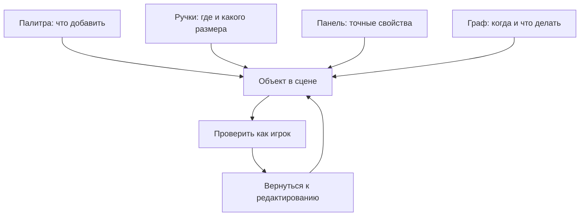
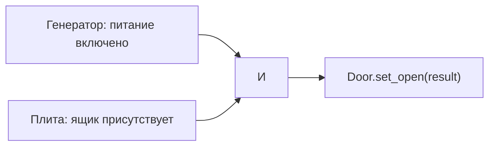
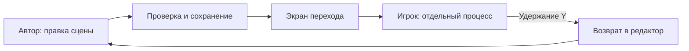

# «Энергоблок VR»: UX разработки игры в VR-редакторе

2026-10-10 · концепция взаимодействия для Godot 4.7.2 и PCVR с двумя контроллерами.

Здесь [игра «Энергоблок»](power_room_desktop.md) становится 3D VR-игрой, а разработчик собирает и проверяет её непосредственно в шлеме. Для каждого из тех же 14 этапов предложены инструменты и интерфейсы.

**Это концепция полного процесса, а не описание готовых возможностей плагина.** Она шире дипломного MVP. Источник объёма — [план](plan.md), детализация — [карта функций](vr_feature_map.md), принятые решения и ограничения — [дневник решений](decisions.md). Сохранение примера в документации не добавляет функции в план реализации.

В документе используются три пометки:

- **MVP** — возможности, необходимые для T1–T3 по текущему плану; пометка не означает, что они уже реализованы или проверены в шлеме.
- **Желательно** — дополнительные возможности из плана и карты функций, если останется время.
- **За пределами MVP** — концепции для более полного редактора. Некоторые из них в текущем плане прямо оставлены настольному редактору.

Исходные модели, звук и базовые компоненты поведения считаем подготовленной библиотекой. Создание этой библиотеки, написание произвольного кода и разработка всех описанных ниже инструментов не становятся бесплатными от переноса интерфейса в VR.

## Что меняется в игре

Сохраняются комната, три батареи, генератор, платформа, робот, ящик, плита и выходная дверь. Меняется способ взаимодействия с ними.

| В настольной игре | В VR-игре |
| --- | --- |
| Взгляд мышью | Положение и поворот головы |
| Движение WASD, прыжок | В качестве исходного варианта — телепорт и дискретный поворот; плавное движение требует отдельной проверки удобства |
| Подбор батареи клавишей E | Захват контроллером и установка в гнездо генератора |
| Активация генератора | Нажатие доступной рукой кнопки после установки трёх батарей |
| Толкание ящика | Захват и перемещение с согласованной физикой |
| Поездка на платформе | Проверяемый вариант поездки либо переход с затемнением между остановками |
| Поимка роботом | Затемнение и возврат к контрольной точке без принудительного поворота головы |
| Экранный HUD | Индикатор генератора, подсказки в мире, краткая панель на запястье |
| Меню на мониторе | Стабильная панель с вводом лучом или касанием |

Телепорт не должен позволять пройти сквозь дверь или обойти задачу с платформой. Допустимые поверхности и переходы задаются правилами уровня. Положение физической головы нельзя приравнивать к положению виртуального тела: человек может шагнуть и наклониться внутри игровой зоны.

Это предложения для **перемещения игрока в игре**. Они не заменяют принятое управление редактором: в проекте уже выбраны плавный полёт, поворот и виньетка по D-015/D-020.

**Сквозная приёмка игры:** новая игра → достать и вставить три батареи → включить генератор → сохранить контрольную точку → завершить процесс → продолжить → поставить ящик на плиту → выйти → увидеть победу.

## Общий язык взаимодействия редактора

Пользователь должен понимать, редактирует ли он объект или взаимодействует с ним как игрок. Режим, цель действия и результат показываются явно.

| Место интерфейса | Для чего использовать | Пример |
| --- | --- | --- |
| Недоминантная рука | Короткий выбор инструмента и быстрые команды | Палитра, отмена, сохранение |
| Непосредственно в сцене | Пространственные параметры | Перенос объекта, размер коллизии, направление света |
| Рядом с выбранным объектом | Короткие контекстные действия | Дублировать, открыть свойства, связать поведение |
| Отдельная рабочая панель | Длительная работа с числами, списками и графом | Inspector, дерево сцены, шкала времени |

Панель для длительной работы можно вынести с руки, расположить удобно и вернуть к себе явной командой. Не следует требовать постоянно держать предплечье поднятым. Закрепление большой панели перед глазами при каждом движении головы — отдельная гипотеза для проверки, а не исходное требование.

Сохраняем понятный каркас управления: Grip — захват, Trigger — выбор или активация, X — инструменты и панели, Y — запуск проверки. Возврат из игры — удержание Y по принятому решению проекта. Подсказка на наведённом объекте объясняет конкретное действие.

Во время захвата панель или инструмент владеет вводом этой руки: одно нажатие не должно одновременно перетаскивать UI и объект сцены. Снап показывает цель до фиксации, точный ввод имеет единицы и шаг, завершённое действие отменяется как одна операция.

## 1. Сформулировать правила

**Объём: за пределами MVP — специальная доска проектирования.**

Разработчик открывает закреплённую в рабочем пространстве доску: «три батареи», «питание включено», «ящик на плите», «дверь открыта». Карточки содержат правило и критерий проверки, а не большие текстовые документы.

Карточку можно связать с объектом, указав на него лучом. При выборе карточки соответствующий объект подсвечивается. Доска скрывается одной командой, чтобы не занимать рабочее пространство постоянно.

Для коротких названий возможны виртуальная клавиатура и диктовка с обязательным просмотром результата. Голосовой ввод не должен молча менять правила или имена.

**Проверка UX:** разработчик понимает зависимости, находит связанный объект и может убрать доску, не потеряв её содержимое.

**Аналогия с backend:** требования и acceptance criteria остаются требованиями; их пространственное расположение лишь помогает соотнести правило с объектом.

## 2. Создать проект и структуру сцен

**Объём: MVP — работа с подготовленными сценами; за пределами MVP — полный мастер создания проекта и настройка ввода из шлема.**

Для полного процесса можно предложить мастер «VR-комната»: название, главная сцена, готовый игрок, начальная карта действий и пресет целевой платформы. Расширенные настройки открываются отдельной панелью.

Сцены проекта представлены миниатюрами и деревом. Миниатюра помогает найти комнату, дерево — выбрать невидимый сервис, вложенную ноду или точного родителя. Перенос в дереве показывает будущего родителя до подтверждения.

Заголовок свойств явно различает «экземпляр Battery в Level» и «исходная сцена Battery»: изменение исходной сцены затронет все экземпляры, а переопределение свойства экземпляра — только его.

**Проверка UX:** пользователь понимает область изменения, может отменить смену родителя и вернуться к нужной сцене.

В MVP проект и его ввод допустимо подготовить на столе. Полный мастер — предложение сверх этого сценария.

## 3. Собрать грейбокс комнаты

**Объём: MVP — примитивы, трансформации, снап и точный ввод; желательно — обзор World-in-Miniature.**

Разработчик открывает палитру, берёт примитив и видит предварительное положение. Перед отпусканием показываются размеры и место снапа. Сначала объект удобно поставить рукой, затем уточнить ограничением по оси или плоскости и числовым вводом.

Для стены полезны ручки граней: потянуть грань и изменить длину, сохраняя противоположную. Для точного проёма — поле размера с единицами, шагом и цифровой клавиатурой. Разработчик не должен добиваться точного числа исключительно неподвижностью руки.

Масштабирование **вида мира** и масштабирование **объекта** — разные инструменты. При работе с миниатюрой комнаты меняется способ просмотра, а не физический размер всех нод. Проверка прохода выполняется в масштабе 1:1.

Это целевой UX: текущая палитра прототипа по D-013 вытаскивает объект в масштабе миниатюры. Предпросмотр конечного размера и иной способ размещения потребуют отдельной реализации и проверки.

**Проверка UX:** можно поставить стену приблизительно, точно задать проём, пройти через него как игрок и отменить изменение одной командой.

## 4. Разместить XR-игрока и настроить взаимодействие

**Объём: MVP — подготовленная сцена игрока как контент; за пределами MVP — конструктор захватов, локомоции и карты действий.**

В палитре находится готовый XR-игрок. При размещении редактор показывает стартовую точку, направление и уровень пола, а также условное тело и зоны досягаемости. Эти подсказки не заменяют проверку настоящим человеком.

В расширенном варианте панель игрока содержит режим перемещения, дискретный поворот и доступные поверхности телепорта. Для батареи можно показать образец руки и настроить положение захвата, а для гнезда — ориентацию и допустимый тип предмета.

Риг редактора и игрок игры имеют разные роли. Риг редактора не сохраняется в `.tscn`. В контенте игры сохраняются настройки и точка появления игрока; активные XR-ноды безопаснее создавать при запуске из подготовленной обвязки.

В проекте уже зафиксирован риск: `XRCamera3D` и `XRController3D` могут следовать за трекерами в редакторе и загрязнять авторские трансформы. Поэтому макет игрока при редактировании не должен превращаться в живой риг игры; ориентир — D-011 и `play_check.tscn`.

**Проверка UX:** до батареи и кнопки можно дотянуться в выбранных режимах сидя и стоя; настройка игрока не перемещает самого автора неожиданным образом.

## 5. Добавить ассеты из библиотеки

**Объём: MVP — палитра готовых сцен и базовый импорт glTF; желательно — назначение готовых материалов; за пределами MVP — расширенный импорт.**

Библиотека показывает категории, названия и объёмные миниатюры. Разработчик берёт батарею или генератор и размещает в комнате. Предварительный вид показывает конечный масштаб, ориентацию и точку соприкосновения с поверхностью.

Для импорта нового файла полный UX может выглядеть так: выбор файла → предпросмотр → проверка масштаба и осей → добавление в библиотеку. Ошибка импорта остаётся доступной в панели, а не появляется только в окне на мониторе.

Материал представлен образцом, который можно применить к объекту или поверхности. Интерфейс показывает, редактируется ли общий ресурс или создаётся отдельная копия: случайная перекраска всех батарей — ошибка области воздействия.

**Проверка UX:** объект попадает в сцену с понятными габаритами, повторные экземпляры используют нужную сцену, а изменение общего ресурса не происходит незаметно.

## 6. Настроить физику и триггеры

**Объём: MVP — статические коллизии, Area3D и ручки форм для T2–T3; за пределами MVP — полноценная настройка динамических тел.**

Режим «Коллизии» делает физические формы заметнее визуальных моделей. Бокс редактируется за грани, сфера — за радиус, капсула — за высоту и радиус. У плиты видна область срабатывания, а не только декоративная поверхность.

Частые пространственные параметры меняются ручками. Масса, трение и именованные слои — через панель. Допустимый объект для плиты назначается указанием на ящик с подтверждением цели.

При редактировании ящик остаётся авторским объектом. Команда «Проверить физику» запускает игровой тест; падение и перемещение ящика во время теста не записываются автоматически в исходную сцену.

**Проверка UX:** пользователь различает форму и меш, точно задаёт область плиты и после теста получает прежнюю авторскую расстановку.

**Аналогия с backend:** значения в документе — исходные данные, состояние физической симуляции — состояние запущенного процесса.

## 7. Собрать логику

**Объём: MVP — минимальный граф событий, условий и действий; за пределами MVP — полный набор игровых модулей.**

Выбираем дверь и открываем её логику. Небольшой граф можно закрепить рядом с объектом; большой — перенести на стабильную рабочую панель. Ноды располагаются на читаемой плоскости: произвольная глубина каждой ноды увеличивает перекрытия и длину связей.

Для двери нужен понятный поток:

Интерактивный [макет двух рабочих пространств графа](assets/power_room_vr_logic.html) позволяет сравнить граф рядом с объектом и отдельную рабочую панель, выбрать дверь и проверить сочетание условий. Это иллюстрация предлагаемого UX, а не подключённый к Godot редактор.

Назначение ссылки выполняется действием «Выбрать объект»: пользователь указывает лучом на дверь, видит имя и подсветку и подтверждает цель. У порта показывается ожидаемый тип. Несовместимый порт или потерянная ссылка дают понятную ошибку; выбранная связь выделяется, остальные не должны закрывать сцену.

Сравнивать два размещения графа следует по времени, правильности и ошибкам выбора объекта, а не по впечатлению от макета. Для T2 настольное условие использует тот же набор нод в плоском GraphEdit, как требует план.

Граф — собственный ресурс плагина в `.tres`; он содержит ноды, связи, параметры и ссылки на объекты. При сохранении компилируется читаемый `.gd`, назначаемый ноде. **`.tres` — формат ресурса, а не встроенный в Godot язык визуального программирования.** Источник правок — граф; ручные изменения сгенерированного кода могут быть перезаписаны.

Для всей игры потребуются подготовленные блоки захвата, гнезда, счётчика, контрольной точки и патруля. Минимальный граф сам по себе не обеспечивает все эти механики: соответствующие компоненты и контракты нужно реализовать.

**Проверка UX:** можно связать нужную дверь с нужной плитой, увидеть причину ложного условия и исправить неверную ссылку без поиска в длинном списке путей.

## 8. Создать анимацию двери и платформы

**Объём: MVP — запуск готовой анимации или move/tween из графа; за пределами MVP — редактор ключей.**

Полный инструмент может работать по схеме «поза → ключ»: поставить дверь в закрытое положение, сохранить ключ, перевести в открытое положение и сохранить второй. Длительность и интерполяция задаются на панели шкалы времени.

Предыдущие положения видны полупрозрачными контурами. Запись ключей включается явно: обычное перемещение объекта не должно незаметно переписывать анимацию. После предпросмотра восстанавливается авторское состояние.

Для платформы так же задаются остановки и цикл. Вариант с поездкой проверяется в самой VR-игре; удобство нельзя подтвердить просмотром траектории из редактора.

**Проверка UX:** понятно, редактируется ли начальное положение или ключ; можно отменить ключ и остановить предпросмотр без остаточного смещения двери.

## 9. Настроить робота и навигацию

**Объём: за пределами MVP.**

Разработчик отмечает поверхности для ходьбы и запускает запекание навигации. Поверх пола появляется сетка; разорванные участки выделяются, чтобы было видно, почему путь не строится.

Точки патруля ставятся лучом и переносятся ручками, линия показывает порядок обхода. Отдельная команда показывает рассчитанный путь до выбранной точки.

У робота отображаются зона обнаружения и направление взгляда. Для правил выбирается подготовленное поведение «патруль → преследование → возврат», а параметры редактируются рядом.

Интерфейс различает три причины сбоя: «путь отсутствует», «игрок не виден» и «переход состояния не выполнен». Общая красная подсветка робота этого не объясняет.

**Проверка UX:** разработчик исправляет непроходимый участок или точку патруля и подтверждает результат запуском игры.

## 10. Настроить свет, материалы, эффекты и звук

**Объём: MVP — размещение света, его основные параметры и базовое пространственное аудио для T2; желательно — материалы из палитры и ручка дальности звука; остальное за пределами MVP.**

Источник света можно взять и направить, дальность и конус изменить ручками. Яркость, цвет и тени доступны в небольшой панели. Для звука нужен выбираемый значок и предпросмотр; расширенный инструмент показывает объём слышимости.

Свет и звук оцениваются из положения игрока. В сцене должны быть собственные свет и окружение: редакторский предпросмотр не должен маскировать тёмный участок, который увидит игрок.

Частицы можно добавить готовым пресетом, а материал — назначить из библиотеки. Детальный редактор материала, окружение, запекание и частицы требуют дополнительных инструментов. Сведение шин в VR — отдельная концепция; по текущей карте функций аудиомикс остаётся на столе.

**Проверка UX:** разработчик понимает область действия источника, не меняет общий материал случайно и слышит тот же игровой эффект после запуска.

## 11. Собрать интерфейс самой игры

**Объём: за пределами MVP; редактор Control и тем сейчас остаётся на столе.**

Для полного процесса полезна библиотека шаблонов: меню, индикатор генератора, панель на запястье, сообщение о победе. Разработчик размещает панель в мире и меняет общие габариты ручками; содержимое настраивает через поля и правила компоновки.

Режимы «Редактировать UI» и «Попробовать UI» переключаются явно. В первом нажатие выбирает элемент, во втором — проверяет его действие. Панели редактора визуально отличаются от UI игры.

Меню паузы может останавливать игровую логику, но должно сохранять работу ввода меню и отслеживания головы. Оно не должно превращаться в неподвижный кадр, который поворачивается вместе с человеком.

**Проверка UX:** текст читается, кнопки достижимы сидя и стоя, панель не перекрывает критичную часть мира, клики не уходят в инструменты редактора.

## 12. Настроить контрольную точку

**Объём: за пределами MVP.**

Готовый компонент предлагает выбрать точку возрождения, событие сохранения и смысловые поля прогресса. Для нашего примера это включённый генератор и идентификатор контрольной точки; ящик, робот и платформа после загрузки возвращаются в начальное состояние.

Панель показывает это правило словами, а не предлагает сохранить всё дерево нод. Доступны команды «Сохранить тестовый прогресс», «Загрузить» и «Очистить тестовый слот».

Сохранение сцены редактора и прогресса игрока имеют разные названия и места в интерфейсе. Версия формата и устойчивые идентификаторы нужны и в VR: положение карточки в графе не является идентификатором игрового объекта.

**Проверка UX:** после полного перезапуска игры генератор включён, батареи уже установлены, игрок стоит в контрольной точке, а исходный документ редактора не изменён.

## 13. Запустить игру и вернуться к правке

**Объём: MVP — цикл play/return и измерение переходов; желательно и за пределами MVP — расширенная отладка.**

Перед запуском интерфейс проверяет наличие рабочего XR-игрока, корректность ссылок и возможность собрать граф. Предлагаемый процесс: проверить → сохранить → показать переход → запустить игру → вернуть автора к редактированию.

В игре руки взаимодействуют с батареей, а не с гизмо. При возврате восстанавливается рабочий контекст автора; сохранение выбора и расположения панелей следует проверить как отдельное требование UX.

Переместившийся при тесте ящик не меняет авторскую расстановку. Перенос изменений из игры в документ потребовал бы отдельной явной команды и собственного механизма; для базового цикла он не нужен.

Для диагностики можно предложить журнал событий с временем и ссылкой на объект: «плита занята», «генератор выключен», «выход И — false». Щелчок по записи после возврата выбирает источник в сцене. Подсветка активных связей графа — желательная функция, а полноценный отладчик в VR потребует отдельной работы.

У проекта есть реальные ограничения, которые макет не устраняет: на SteamVR игра запускается без встроенного отладчика, а повторно созданная сессия редактора имеет известную проблему темпа кадров (D-012). Нельзя считать журнал, мгновенный возврат или комфорт доказанными до реализации и замеров.

**Проверка UX:** человек меняет размер проёма, проверяет его как игрок, возвращается и продолжает работу без снятия шлема. Время перехода и ошибки измеряются; численные результаты берутся только из замеров.

## 14. Экспортировать и проверить сборку

**Объём: за пределами MVP; по текущему плану экспорт выполняется на столе.**

Для гипотетического полного процесса панель экспорта показывает целевую платформу, пресет, главную сцену, путь результата и журнал ошибок. Пресет можно подготовить заранее, но изменение пути и сообщение об отсутствующих шаблонах не должны требовать невидимого диалога на мониторе.

После сборки доступен запуск именно экспортированной игры. Разработчик проходит приёмку, возвращается и видит результат. Сборка и публикация — отдельные действия; успешный экспорт сам по себе не означает релиз.

Импорт, запекание и экспорт могут надолго занимать движок. Для процесса без снятия шлема нужно отдельно исследовать, как сохранять отзывчивый XR-вид и показывать прогресс. Одна панель с полосой загрузки не решает блокировку главного потока.

**Проверка UX:** дистрибутив запускается вне редактора, использует нужные ресурсы и сохраняет прогресс. Это дополнительная возможность будущего редактора, а не критерий завершения текущего MVP.

## Что нужно реализовать в редакторе

Разнообразие этапов сводится к нескольким повторяемым механизмам:

| Механизм | Какие этапы обслуживает | Основная трудность |
| --- | --- | --- |
| Выбор, захват, ручки и снап | Грейбокс, коллизии, свет, точки и панели | Точная работа при движении рук |
| Библиотека сцен, ресурсов и поведения | Игрок, объекты, материалы, готовые механики | Масштаб, поиск и область изменения |
| Панели свойств и точного ввода | Числа, имена, списки, настройки | Читаемость, ввод и усталость |
| Указание на объект и граф связей | Логика и назначение ссылок | Ошибки адресации и сложность графа |
| Проверка и возврат к правке | Все игровые механики | Отдельные процессы, XR-сессии и сохранение контекста |
| Отмена, сохранение и логирование | Все изменения документа | Согласованность с настольным редактором |

Все авторские изменения проходят через `XREDocument`. Перетаскивание — предварительные изменения и один commit в конце. Это сохраняет единую историю отмены и позволяет учитывать источник операций: 3D-инструмент или панель.

VR-интерфейс и риг редактора не попадают в сцену игры. Настольный и XR-вьюпорты редактора смотрят на один `World3D`; отдельный процесс игры при проверке имеет собственное состояние. Граф сохраняется как `.tres` и компилируется в `.gd` согласно инвариантам проекта.

## Как ограничить дипломный объём

Полная VR-версия «Энергоблока» показывает, что понадобится зрелому редактору. Для диплома следует выделить меньший срез и использовать подготовленный контент.

| Задача исследования | Срез примера | Что оценивать |
| --- | --- | --- |
| T1: компоновка | Расставить объекты и два источника света, точно задать часть параметров | Время и ошибка размещения |
| T2: логика | Выбрать нужную из похожих дверей, связать триггер, свет и звук | Правильность и ошибки адресации |
| T3: итерация | Исправить недоступную платформу, тёмный участок и триггер; проверить каждую правку | Время и число циклов правка–проверка |

Практический срез для разработки инструмента: поставить дверь → настроить коллизию → связать триггер с нужной дверью → запустить → вернуться → исправить размер → отменить изменение. Он проверяет основные паттерны без реализации всего конструктора игр.

Преимущество VR в пространственных задачах, преимущество графа рядом с объектом и сокращение времени итерации остаются гипотезами. Полезный результат исследования может включать и задачи, в которых настольный интерфейс окажется лучше.

## Материалы для уточнения

- [План и задачи T1–T3](plan.md), [карта функций и приоритеты](vr_feature_map.md), [принятые решения](decisions.md).
- Godot: [room-scale XR](https://docs.godotengine.org/en/stable/tutorials/xr/xr_room_scale.html), [OpenXR action map](https://docs.godotengine.org/en/stable/tutorials/xr/xr_action_map.html), [введение в XR Tools](https://docs.godotengine.org/en/stable/tutorials/xr/introducing_xr_tools.html). Ссылки `stable` обновляются; API сверяется с закреплённой 4.7.2. XR Tools здесь — справочный пример готовых компонентов, не решение о новой зависимости проекта.
- [Рекомендации Microsoft по комфорту](https://learn.microsoft.com/en-us/windows/mixed-reality/design/comfort) и [Meta по взаимодействию рук с 3D-объектами](https://developers.meta.com/vr/design/hands-3d-best-practices/) — фон для проектирования, а не доказательство удобства предложенного интерфейса.

Парный документ: [разработка «Энергоблока» в обычном Godot](power_room_desktop.md).
